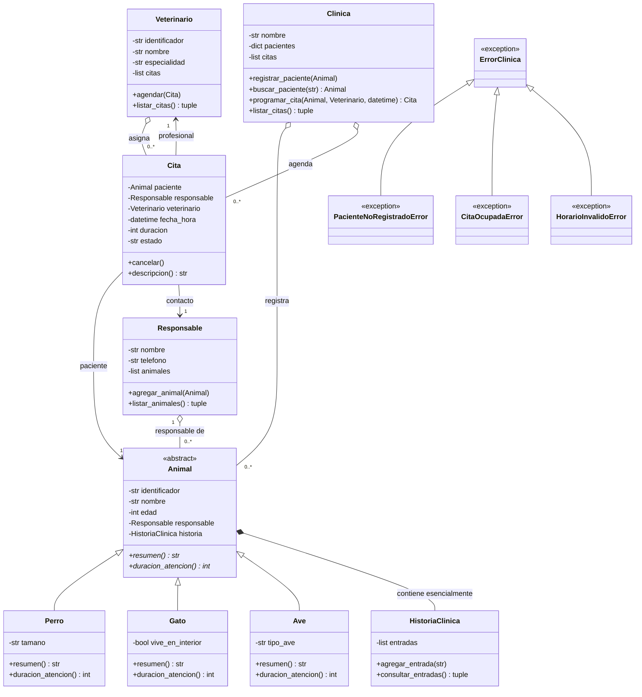

# Diagrama UML de clases

El diagrama corresponde a la implementación de `src/modelos.py`, `src/clinica.py` y `src/excepciones.py`.

La composición se usa entre `Animal` e `HistoriaClinica`: el historial se crea dentro del constructor del paciente y se consulta desde ese paciente. Responsable, clínica, veterinario y cita se vinculan mediante asociaciones porque existen como entidades relacionadas con responsabilidades propias.
